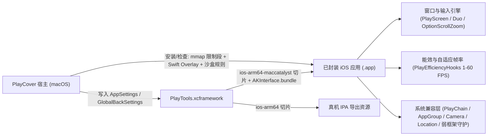
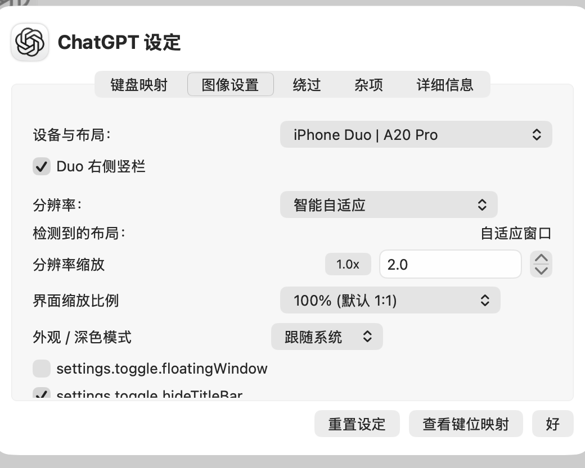
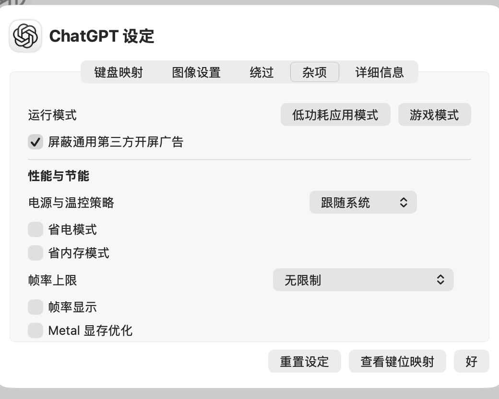
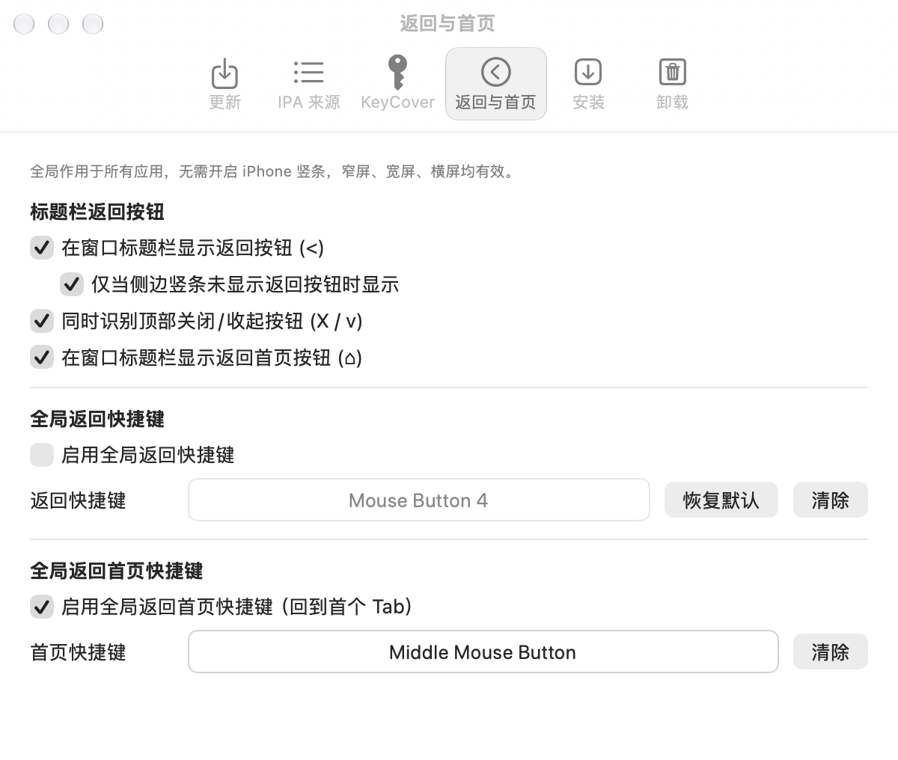
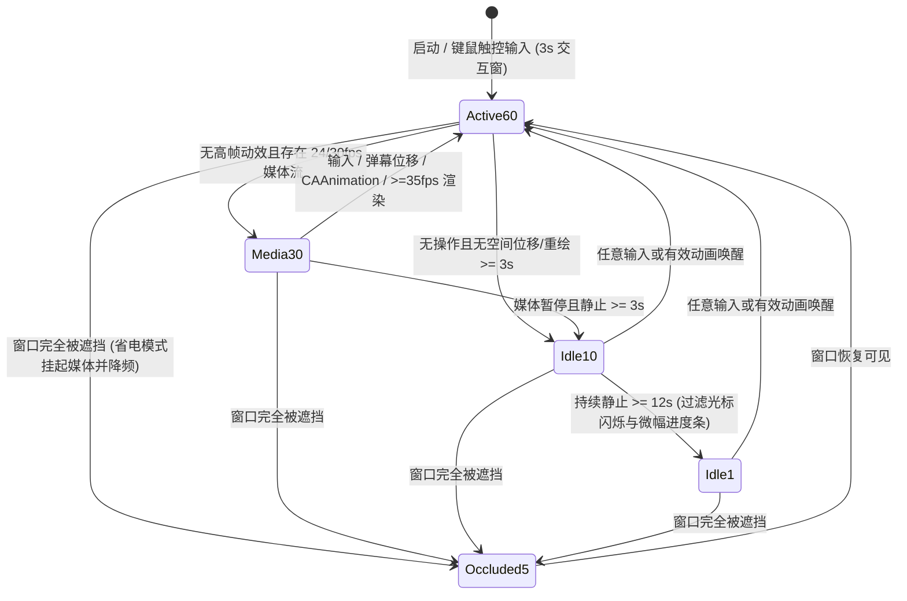

# PlayCover (Personal Compatibility & Desktop Fork)

PlayCover 是一款在 Apple Silicon Mac 上以原生方式运行 iOS 应用与游戏的开源启动器与封装工具（支持键鼠、手柄映射及多窗口显示）。本仓库（[`Rengwang/PlayCover`](https://github.com/Rengwang/PlayCover)）基于上游 [`PlayCover/PlayCover`](https://github.com/PlayCover/PlayCover)（`develop`）维护，与配套运行时 [`Rengwang/PlayTools`](https://github.com/Rengwang/PlayTools)（`master`）协同构建，重点面向**桌面端日常应用窗口适配、功耗与内存控制、以及真实复杂应用在 Mac Catalyst 下的兼容性修复**。

> [!NOTE]
> 本文档聚焦本分支相对原版所做的工程改动、实测对比与已知边界；详细构建命令与逐项变更记录请参阅 [维护手册](docs/MAINTENANCE.md) 与 [性能与兼容性核查](docs/PERFORMANCE.md)。

---

## 一、整体架构：宿主与运行时协同

本分支维持宿主仓库与运行时仓库分离的双切片构建链路：宿主在安装与启动阶段负责二进制检查、沙盒规则、权限签名与图形/能效配置下发；运行时在 Mac Catalyst 与 iOS 双平台切片下完成窗口几何调度、输入转换、自适应帧率与系统框架兼容。



---

## 二、界面概览

<div align="center">
  <table>
    <tr>
      <td align="center" width="50%">
        
        <br /><sub><b>显示与设备布局</b>：iPhone Duo 布局、右侧竖栏开关、智能自适应窗口、界面缩放与外观模式</sub>
      </td>
      <td align="center" width="50%">
        
        <br /><sub><b>运行模式与性能节能</b>：低功耗应用模式、省电/省内存、自适应限帧、Metal 显存与音视频节能</sub>
      </td>
    </tr>
    <tr>
      <td align="center" colspan="2">
        
        <br /><sub><b>全局返回与首页导航</b>：无需依赖侧边竖条即可跨应用使用标题栏按钮与鼠标侧键/键盘快捷键返回</sub>
      </td>
    </tr>
  </table>
</div>

---

## 三、相比原版的主要优化与差异

| 领域 | 原版行为 | 本分支改动与实际收益 |
| --- | --- | --- |
| **窗口与多形态布局** | 以固定比例缩放或通用 Resizable 窗口为主，缺少折叠屏双栏语义与跨启动尺寸记忆 | 新增 **Smart Auto-Adapt（`resolution = 7`）** 自动识别自适应与等比画布；新增 **iPhone Duo（`iPhone19,4`）** 与 **52pt 右侧竖栏**；支持窗口位置/尺寸持久化、Catalyst UI Scale（`0.77x–2.0x`）、动态 Live-Resize 帧提交耗时节流及 iOS 26/27 自定义 TabBar 浮胶囊自动隐藏 |
| **桌面输入与导航** | 依赖游戏按键映射或应用内返回按钮，默认不支持双指缩放快捷键 | 新增 **全局返回 / 回首页**（支持标题栏按钮与鼠标侧键/键盘快捷键）；新增 **Option + 滚轮** 以光标为中心捏合缩放；合并并适配滚轮速度滑块与无 MouseArea 滚轮拖拽 |
| **日常模式与能效控制** | 默认偏游戏场景（开启按键映射、后台轮询与电源伪装），缺少统一帧率与显存/视频节流开关 | 默认启用 **低功耗应用模式**，提供 **Switch Manager 开关总控**；修复后台手柄/摇杆空转唤醒与滑动计时器对象泄漏；新增 **省电 / 省内存 / Metal 显存优化 / 音视频节能** 及每应用浅色/深色外观覆盖 |
| **iOS 语义自适应帧率** | 仅支持系统默认刷新率或简单全局限制 | 新增 **`1–60 FPS` 自适应调度** 与轻量化左上角 FPS 悬浮胶囊（详见下方状态机图） |
| **系统与框架兼容** | 部分新系统/三方框架在 Catalyst 下因路径空格、弱符号空指针、相机坐标系或 Keychain 匹配差异崩溃 | 修复 **App Group 无空格路径迁移**、**OneNote 启动场景衔接**、**C++ 流退出保护**、**`MSCWebView` 鼠标转触控**、**相机水平角校准与前后摄独立镜像**、**MapKit 虚拟定位**、**`WirelessInsights` / `MarketplaceKit` / 弱框架守护**、**`CloudKit` 缺失权限存根**、**`PlayChain` 全属性精确匹配与连接池化** |
| **宿主启动与工程维护** | 启动检查整文件读入主二进制，图标依赖同步 `NSWorkspace`，无统一 CLI 与双仓库脚本 | 启动限制段检查改用只读 `mmap` + 指纹缓存（311 MiB 主二进制实测单次检查中位数从 `19.07 ms / 316.8 MiB` 降至 `0.078 ms / 5.8 MiB`）；支持包内直读图标（避免同步 `lsd` 卡顿）、`--install-ipa` 无头 CLI 与 154 项自动化不变式检查 |

### iOS 语义自适应帧率状态转换（`frameRateCap = -1`）



---

## 四、实测数据与已知边界

所有对比测量均明确标注测试条件与归因边界，不夸大效果：

- **自动化回归**：`PlayTools/Tests/check-compat-invariants.py` 与 7 个专项测试脚本最近一轮 **154 passed / 0 failed**。
- **并发应用回归（2026-11-27）**：对 63 款已安装应用在 Sidecar 下进行并发冒烟采样，**61/63** 正常完成窗口挂载与退出且 **0 新增应用崩溃（`.ips`）**；`com.burbn.instagram` 与 `com.facebook.Facebook` 呈现与关闭所有能效/限帧开关对照组一致的既有白屏超时。
- **功耗与内存对照（2026-11-23，Apple M5）**：UpTimer 与酷安在隐藏 20 秒采样中，未见额外后台 CPU 空转；不同运行机制（App Store iOS-on-Mac vs Catalyst）存在结构性内存差异，具体数据与未完成验收项见 [性能与兼容性核查](docs/PERFORMANCE.md)。
- **风控与开屏边界**：开屏拦截与 SDK 风险提示中性化仅处理客户端本地弹框与已知广告协议，**服务端校验与重签名校验不在客户端可控范围内**。

---

## 五、本地双仓库构建

```sh
mkdir playcover-workspace && cd playcover-workspace
git clone -b develop https://github.com/Rengwang/PlayCover.git PlayCover
git clone -b master https://github.com/Rengwang/PlayTools.git PlayTools
git -C PlayCover remote add upstream https://github.com/PlayCover/PlayCover.git
git -C PlayTools remote add upstream https://github.com/PlayCover/PlayTools.git

./PlayCover/Tools/Workspace/sync_upstream.sh build
./PlayCover/Tools/Workspace/sync_upstream.sh install
```

更多说明（固定签名身份、无头安装 CLI `--install-ipa`、`sync` 变基流程）请见 [维护手册](docs/MAINTENANCE.md)。

---

## 六、致谢与上游贡献

- 核心项目与基础架构来自上游 [`PlayCover/PlayCover`](https://github.com/PlayCover/PlayCover) 与 [`PlayCover/PlayTools`](https://github.com/PlayCover/PlayTools) 社区维护者。
- 本分支已合并以下上游社区 PR（均保留原作者归属，未作为个人原创重复提交）：
  - **PlayCover**: `#2187` (`RyouDYFZ`)、`#2195` & `#2199` (`EmilyTsum`)、`#2249` (`BettTer`)、`#2283` (`Ryu-ga`)、`#2285` (`hematenergi`)
  - **PlayTools**: `#229` (`hedssaz`)、`#241` (`BettTer`)、`#249` (`neverlock`)、`#251` (`jingerpie`)、`#263` (`kts-kris`)
- 本分支中通用性较好的独立修复与特性已同步拆分提交 PR 回馈上游仓库。

<details>
<summary>License</summary>

Distributed under the GPLv3 License. See [LICENSE](LICENSE) for more information.

</details>
